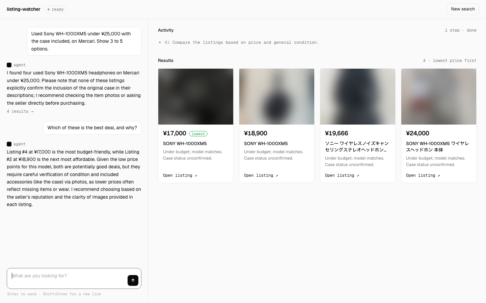
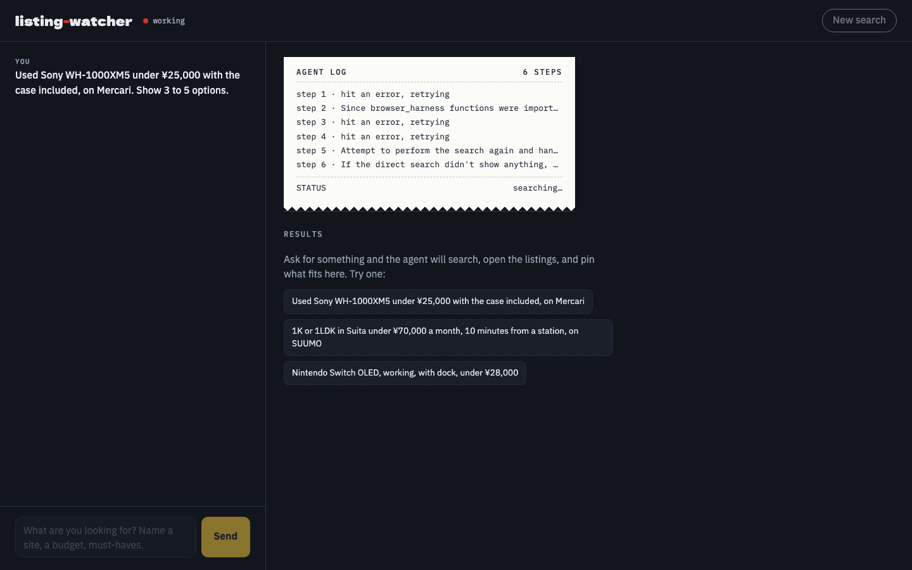

# listing-watcher

Chat with a browser agent that shops for you. Ask for something in plain words. The agent opens a real browser, searches sites like Mercari or SUUMO, opens the promising listings to check condition and details, and answers with a short list. Follow up to refine, compare, or dig into one listing. It keeps the same browser and remembers the results.

Built on [browser-use](https://github.com/browser-use/browser-use). Bring your own model: Google Gemini (free tier works), Anthropic, OpenAI, or a local Ollama model.



## Setup

Requires Python 3.11+.

```bash
git clone https://github.com/TushirSahu/listing-watcher && cd listing-watcher
python3 -m venv .venv && source .venv/bin/activate
pip install -e .
cp .env.example .env      # choose a provider, paste your API key
```

The agent uses your installed Chrome/Chromium/Edge with a fresh, empty profile (never your logged-in sessions). No Chrome installed? `pip install playwright && playwright install chromium`.

## Use

### In your browser

```bash
listing-watcher web            # then open http://localhost:8000
```

Chat on the left. On the right, the agent log prints each step as the agent works, and results are pinned as price tags (photo, price, why it fits, link), cheapest first. Ask follow-ups by number: "check #2's photos". **New search** starts over. The page only listens on your own machine.



### In the terminal

```
you> used Sony WH-1000XM5 under 25000 yen with the case included, on Mercari
agent> I found a used Sony WH-1000XM5 on Mercari for 18,900 yen that includes the original carrying case.
  1. ¥18,900  SONY WH-1000XM5
     The listing is for a used Sony WH-1000XM5 and explicitly states that the dedicated carrying case and charging cable are included.
     https://jp.mercari.com/item/m56708452240

you> check #1 more closely: condition, what is included, shipping
agent> The item (#1) is a used Sony WH-1000XM5 priced at 18,900 yen. The seller includes the dedicated carrying case and charging cable. Shipping is included in the price via 'Yu-Yu Mercari Bin', and it is expected to be shipped within 4-7 days.
```

```bash
listing-watcher chat                  # browser runs hidden
listing-watcher chat --show-browser   # watch the agent work
```

- Ask for anything listed on a site: used items, new items, rentals. Name a site ("on Mercari") or let the agent pick (Mercari / Yahoo Auctions / Rakuma for used goods, Amazon.co.jp for new, SUUMO for rentals).
- Follow up in plain words: "only ones with the case", "check #2's photos", "now try Rakuma", "which is the best deal?".
- `/new` starts a fresh search (new browser, no memory). `/quit` or Ctrl+D exits.

How results are kept honest:

- **Price is what you actually pay:** item plus shipping, or rent plus management fee (管理費/共益費). One-time costs (deposit, key money) are mentioned in the text instead.
- **Sold or reserved listings are skipped.** Duplicates are merged, including the same flat listed by several agencies, keeping the cheapest.
- **Requirements a listing doesn't mention** (e.g. "foreigner-friendly") are flagged as unconfirmed instead of silently dropped.
- **Read-only:** it never logs in, buys, or messages anyone.

## Models and cost

Every agent step is one model call, and a request usually takes 10–40 steps. A small, fast model is enough.

**Free option: Google Gemini.** Get a key at aistudio.google.com, then set `LLM_PROVIDER=google` and `LLM_MODEL=gemini-flash-lite-latest` (or another lite model). The free tier has per-minute limits on requests and tokens. The agent retries rate-limit errors automatically, so a turn may pause for a bit. Big pages (SUUMO) can hit the token limit; set `LLM_MAX_CONTEXT_CHARS=60000` in `.env`. Free lite models are sometimes careless with titles; a paid model (e.g. Gemini Flash or GPT mini) gives more consistent results.

**Ollama is best-effort.** Small local models often get lost on real sites.

## Be a good citizen

This tool is for personal use. You are responsible for following each site's terms.

## Development

```bash
pip install -e '.[dev]'
pytest
```
